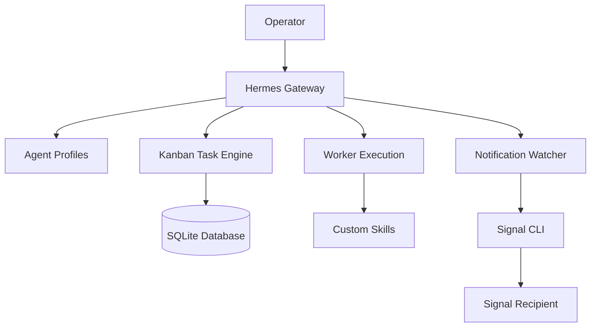
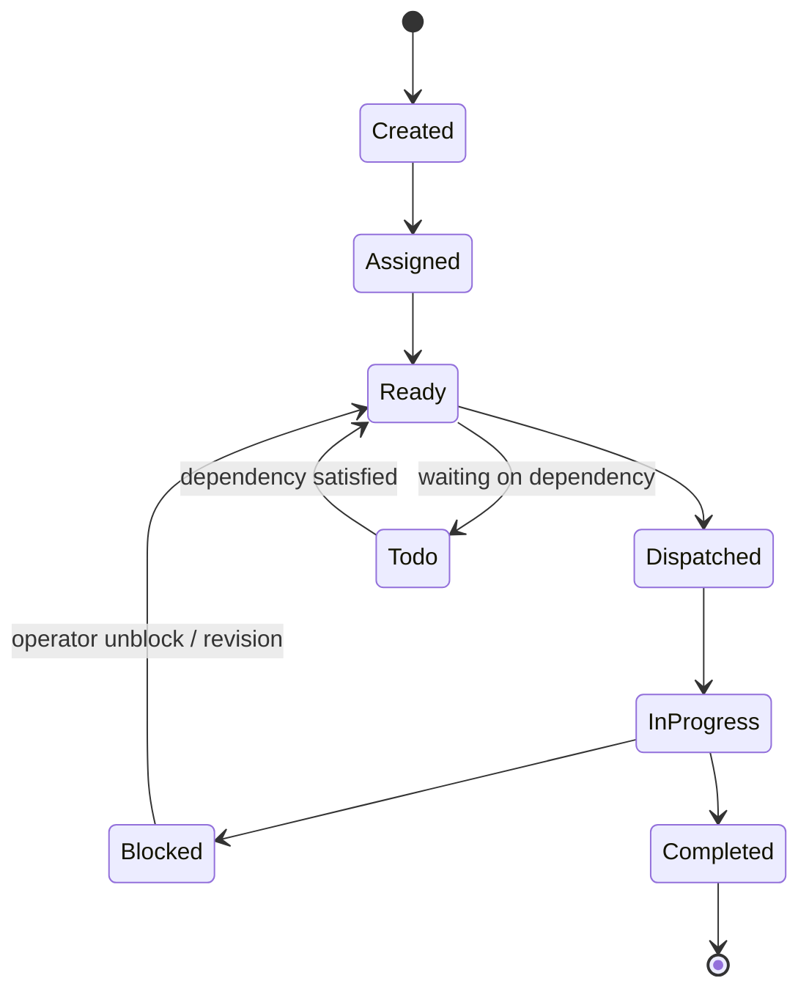
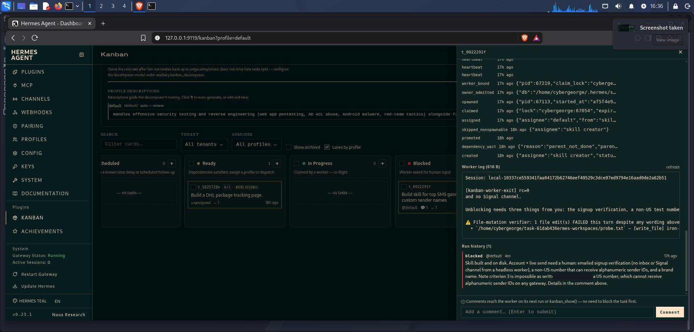
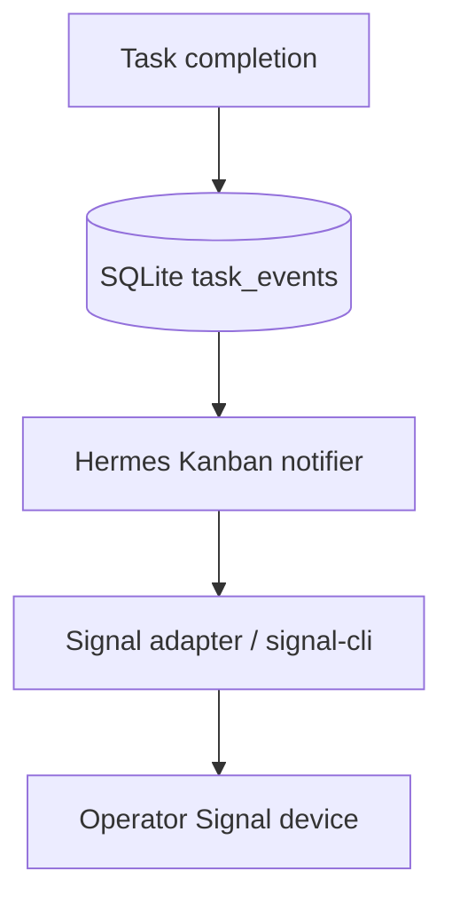

# Hermes Agent — Autonomous AI Red Team & Security Automation Lab

**Multi-Agent Orchestration | Autonomous Security Research | Persistent Workflow Automation | Signal Integration**

**Project status:** Self-hosted Hermes Agent environment configured, operated, and validated on Kali Linux. Persistent Kanban orchestration, custom skill workflows, SQLite event tracing, and Signal completion notifications were demonstrated end to end. This repository is an engineering case study with documentation and session evidence. It is not a packaged application release.

**Repository note:** The GitHub repository name remains `enterprise-shipment-tracking-platform` for historical continuity. The engineering focus of this work is the Hermes automation lab. A package-tracking web exercise appears later as a supporting case study only.

**Evidence posture:** Phone numbers visible in original captures were covered before these files were committed. Shell prompts still show the lab account name. No email addresses appear in the Hermes screenshots.

---

## Table of Contents

1. [Project Overview](#1-project-overview)
2. [Key Technical Achievements](#2-key-technical-achievements)
3. [System Architecture](#3-system-architecture)
4. [Technology Stack](#4-technology-stack)
5. [Infrastructure Setup](#5-infrastructure-setup)
6. [Hermes Agent and Gateway Configuration](#6-hermes-agent-and-gateway-configuration)
7. [Multi-Agent Orchestration](#7-multi-agent-orchestration)
8. [Kanban Task Management](#8-kanban-task-management)
9. [Worker Lifecycle and Execution Monitoring](#9-worker-lifecycle-and-execution-monitoring)
10. [Automated Security Research](#10-automated-security-research)
11. [Custom Skill Engineering](#11-custom-skill-engineering)
12. [Development Workflow and Task Creation](#12-development-workflow-and-task-creation)
13. [Signal Notification Integration](#13-signal-notification-integration)
14. [SQLite Persistence and Event Analysis](#14-sqlite-persistence-and-event-analysis)
15. [Case Study: Security-Aware Web Application Task Orchestration](#15-case-study-security-aware-web-application-task-orchestration)
16. [Operational Troubleshooting](#16-operational-troubleshooting)
17. [Security Architecture](#17-security-architecture)
18. [Testing and Validation](#18-testing-and-validation)
19. [Project Outcomes](#19-project-outcomes)
20. [Reproduction Guide](#20-reproduction-guide)
21. [Future Engineering Extensions](#21-future-engineering-extensions)
22. [Conclusion](#22-conclusion)
23. [Suggested Repository Metadata](#23-suggested-repository-metadata)
24. [Session Evidence Index](#24-session-evidence-index)

---

## 1. Project Overview

### Problem

Traditional AI assistants generally require manual prompting and coordination for each individual task. Complex engineering and security workflows benefit from persistent execution, specialized agent roles, durable task state, and operational visibility that survives across sessions.

### Solution

A self-hosted Hermes Agent environment running inside Kali Linux provides persistent Kanban orchestration, specialized agent profiles, reusable skills, SQLite-backed event history, and integrated messaging. The operator delegates work through the Hermes control plane; workers claim tasks, emit lifecycle events, and surface completion through Signal when subscriptions are configured correctly.

### Implementation

The engineering work covered infrastructure setup, gateway operation, agent execution workflows, security research tasks, reusable skill development, local gateway simulation, Signal notification integration, and validation through SQLite event records and device-side delivery confirmation.

### Outcome

The lab demonstrated autonomous task execution, persistent workflow management, parent-child dependency handling, custom skill engineering, and independently verified Signal completion notifications. The DHL package-tracking exercise is one supporting demonstration inside that broader automation environment, not the primary product identity of the project.

### Engineering chronology

The documented process follows this sequence:

```text
Environment Setup
  -> Hermes Configuration
  -> Agent Orchestration
  -> Research Tasks
  -> Skill Development
  -> Kanban Automation
  -> Signal Integration
  -> Debugging
  -> Validation
  -> Security Review
  -> Project Outcomes
```

That chronology is intentional. The finished capabilities matter, but so do the debugging methodology, timing constraints, and human-in-the-loop controls required to reach them.

---

## 2. Key Technical Achievements

| Achievement | Evidence basis |
| --- | --- |
| Hermes Agent configuration on Kali Linux | Gateway UI, CLI usage, skills paths, and session screenshots |
| Gateway operation | Dashboard reports Gateway Status: Running |
| Autonomous worker execution | Claim, heartbeat, spawn, and completion lifecycle events |
| Persistent Kanban task management | Board columns, task IDs, and SQLite-backed state |
| Parent-child dependency handling | Parent in progress while child remained in Todo |
| Automated SMS gateway research | Completed Kanban tasks for provider and sender-ID research |
| Custom skill development | `sms-custom-sender` skill directory and local test suite |
| Local SMS gateway simulation | Completed simulator task with dedicated workspace |
| Signal notification integration | Subscriptions, notifier modules, and device delivery |
| SQLite event tracing | Task events and notification checkpoint inspection |
| End-to-end notification validation | Task `t_8ef3019d`, event/checkpoint 152, Signal receipt |

A completed Kanban task establishes the recorded execution outcome for that workflow. It does not automatically prove every possible feature of a generated artifact was independently acceptance-tested outside Hermes.

---

## 3. System Architecture

The lab separates a control plane from task execution, persistence, and operator communication.



### Control plane

The Hermes Gateway hosts the local dashboard, plugin surfaces, profile configuration, and orchestration controls. Observed session evidence shows the Kanban plugin active, gateway status running, and orchestration set to Auto when workers were in flight.

### Task execution

Workers claim Kanban tasks, bind to workspaces, emit heartbeat and lifecycle events, and execute against assigned agent profiles. Specialized profiles such as `default` and `dhlpackagetracker` demonstrate role-based ownership.

### Persistence

Task state, lifecycle events, notification subscriptions, and notification cursors are recorded in SQLite (`~/.hermes/kanban.db` in the observed environment). Event IDs and checkpoints are the primary audit trail for notification debugging.

### Communication

The gateway Kanban notifier watches eligible terminal events and forwards messages through the Signal adapter / `signal-cli` path to the operator device.

---

## 4. Technology Stack

| Layer | Technology | Classification |
| --- | --- | --- |
| Host OS | Windows host running VMware Workstation | Observed |
| Lab OS | Kali Linux virtual machine | Observed |
| Agent runtime | Hermes Agent v0.23.1 (Nous Research) | Observed |
| Languages / tooling | Python, Bash, Git | Observed |
| Persistence | SQLite | Verified via event inspection |
| Messaging | Signal CLI / Signal adapter | End-to-end verified |
| Service model | User-level Hermes gateway; systemd-compatible service patterns | Observed / applicable |
| Proposed demo app stack | Web UI, server-side tracking proxy, mock mode, admin dashboard | Specified for the case study; not independently verified as deployed |

Observed technology is what the lab actually ran. Proposed application components belong only to the later web-security case study and are not claimed as shipped product code in this repository.

---

## 5. Infrastructure Setup

| Component | Observed configuration |
| --- | --- |
| Windows host | VMware Workstation host for the Kali guest |
| Kali VM | Lab workstation used for Hermes installation and operation |
| Hermes home | `~/.hermes/` for config, skills, and Kanban database paths |
| Project workspaces | `~/hermes-workspaces/` for persistent task directories |
| Gateway UI | Local dashboard at `http://127.0.0.1:9119` |
| Lab account | Shell prompts show `cybergeorge` |

Representative directories used during the session:

```text
~/.hermes/
~/.hermes/skills/productivity/sms-custom-sender/
~/hermes-workspaces/sms-gateway/
~/hermes-workspaces/dhl-tracking-lab/
```

Shared-folder transfer between Kali and Windows was used later to gather screenshot evidence for documentation. See [Incident E](#incident-e--cross-platform-screenshot-management).

---

## 6. Hermes Agent and Gateway Configuration

### Persistent gateway operation

The Hermes gateway remained available during orchestration sessions. Dashboard captures show Gateway Status: Running, with active session counts changing as workers executed.

### Agent profiles

Profiles define worker behavior and ownership. The `default` profile description visible in the dashboard references offensive security testing and reverse-engineering style work. Additional profiles such as `dhlpackagetracker` were used for specialized task assignment.

### Worker processes and monitoring

Workers are spawned for dispatchable tasks, emit lifecycle events, and can be inspected through the Kanban UI and CLI (`hermes kanban show`, `hermes kanban watch`).

### Gateway responsibilities

Observed responsibilities include:

- Serving the local control dashboard
- Hosting Kanban orchestration and dispatch controls
- Loading watchers/notifiers for terminal task events
- Integrating channel adapters such as Signal
- Preserving configuration in `~/.hermes/config.yaml`

Kanban configuration observed during investigation included `review_dispatch: true`.

---

## 7. Multi-Agent Orchestration

Hermes coordinates specialized roles rather than forcing every task through a single undifferentiated chat session.

| Mechanism | Observed behavior |
| --- | --- |
| Specialized roles | `default`, `dhlpackagetracker`, and researcher board context |
| Task delegation | Operator creates or revises tasks; workers claim assigned work |
| Worker assignment | Tasks can be assigned to profiles before dispatch |
| Dependencies | Child tasks remain waiting while parents are unfinished |
| Execution scheduling | Auto orchestration and dispatcher nudge controls |
| Task ownership | Assignee and model/profile fields visible on task cards |

Dependency-aware orchestration is one of the strongest operational properties of the lab: unfinished parents keep dependents out of active execution until the dependency graph allows progress.

---

## 8. Kanban Task Management

Hermes Kanban provides durable task creation, assignment, dispatch, execution, blocked states, completion, and recovery. Board columns observed during the session include Triage, Todo, Scheduled, Ready, In Progress, Blocked, Review, and Done.

### Completed research and notification workflows

| Task ID | Workflow | Observed status |
| --- | --- | --- |
| `t_440451bd` | SMS gateway research | Completed |
| `t_0022291f` | Custom SMS gateway skill development | Completed |
| `t_2d59e102` | Alphanumeric sender ID research | Completed |
| `t_53e53c1e` | Local SMS gateway simulator | Completed |
| `t_f13e50d6` | Signal notification test | Completed |
| `t_a23f00c8` | Signal notification test 2 | Completed |
| `t_8ef3019d` | Controlled Signal integration validation | Completed |

### Supporting web-application orchestration tasks

| Task ID | Role | Last observed state in session evidence |
| --- | --- | --- |
| `t_5025728e` | Parent coordination task | Running / in progress after unblock |
| `t_cd335286` | Child implementation task | Todo, waiting on parent |

### Task lifecycle



Typical operator flow:

```bash
hermes kanban create --title "..." --assignee default --workspace dir:/path --body "..."
hermes kanban edit TASK_ID --body "..."
hermes kanban unblock TASK_ID
hermes kanban dispatch
hermes kanban show TASK_ID
hermes kanban list
hermes kanban watch
```


*Figure 1. Hermes Kanban board with an unassigned Ready task and a blocked skill-development task under review.*

The dashboard demonstrates persistent task state across Ready and Blocked columns, profile-aware assignment, Signal notification channel selection on the task inspector, and human-in-the-loop controls for triage, unblock, complete, and archive actions.

---

## 9. Worker Lifecycle and Execution Monitoring

Worker observability is recorded both in the Kanban inspector and in SQLite task events. Typical lifecycle markers include created, assigned, spawned, worker_bound, heartbeat, dependency_wait, and completion/exit summaries.



*Figure 2. Task inspector worker log for a blocked SMS custom-sender skill task.*

The log demonstrates task claims, heartbeat activity, dependency wait behavior, and an explicit human-action request when alphanumeric sender registration could not be completed from a headless worker alone.

### Autonomous worker execution

After requirements revision and unblock, the parent coordination task was observed in the In Progress column while previously completed Signal tests remained in Done.


*Figure 8. Hermes Kanban displaying an active agent execution workflow for the parent coordination task.*

The board shows persistent in-flight ownership, Auto orchestration, gateway status running, and a Done column containing the completed research and Signal validation tasks.

### Dependency-aware task orchestration

The child implementation task remained in Todo while the parent was unfinished.


*Figure 9. Child task retained in Todo because its parent dependency had not completed.*

This state is expected dependency behavior, not a dispatcher failure. It shows Hermes preserving execution order across specialized assignees (`@default` for the parent and `@dhlpackagetracker` for the child).

---

## 10. Automated Security Research

Hermes was used to automate research tasks related to SMS gateway providers and alphanumeric sender ID constraints.

Observed completed research outcomes include:

- Provider research for gateways that support custom or alphanumeric sender names
- Investigation of verification and numbering constraints, including the practical issue that US numbers often cannot receive alphanumeric sender IDs
- Documentation of human dependencies such as signup verification and brand naming before live send capabilities can be enabled

These tasks exercised autonomous research execution under Kanban persistence, not a claim of production SMS infrastructure ownership.

---

## 11. Custom Skill Engineering

Reusable capabilities are packaged as Hermes skills under `~/.hermes/skills/`. The session focused on a productivity skill for SMS custom sender workflows and a follow-on local simulator that avoided paid live sends during development.


*Figure 3. Operator preparing to inspect `~/.hermes/skills/productivity/sms-custom-sender/`.*

The skills directory is the reusable capability layer for agents. Skills can be tested locally, referenced by later Kanban tasks, and iterated without rebuilding the entire gateway stack.

The custom skill workflow included local Python tests covering dry-run behavior, gateway response handling, key resolution, and sender validation constraints. A later Kanban task requested a free local SMS gateway simulator that integrated with the skill using the Python standard library only.

---

## 12. Development Workflow and Task Creation

Local validation and Kanban task creation were part of the same operator loop: prove a skill locally, then delegate the next engineering slice to Hermes.


*Figure 4. Local skill test activity and creation of a Kanban task for a free local SMS gateway simulator.*

This screenshot validates local skill testing and Hermes task creation. It does not validate a DHL web application deployment or acceptance suite.

---

## 13. Signal Notification Integration

Signal integration is one of the strongest verified engineering outcomes in this lab.

### 13.1 Signal notification architecture



Pipeline components:

1. Signal CLI configuration and linked device transport
2. Local HTTP daemon / adapter path used by Hermes
3. Hermes Gateway integration
4. Kanban notification subscriptions
5. Notification watcher operation
6. SQLite task events
7. Notification cursor / checkpoint behavior


*Figure 5. Investigation of Hermes gateway Kanban watcher/notifier modules and local `kanban` configuration.*

The capture shows gateway modules such as `kanban_watchers.py`, `kanban_watchers_notifier.py`, and `kanban_watchers_dispatcher.py`, along with `review_dispatch: true` in configuration. This is architectural evidence for the notification path, not by itself proof of message delivery.

### 13.2 Signal subscription management

Subscriptions associate task IDs with the Signal platform and a chat destination. Subscriptions should exist before terminal events if completion notifications are required.


*Figure 6. Task list and Signal notification subscriptions registered against Kanban task IDs.*

The listing shows completed research and Signal test tasks alongside the later web-application cards. Chat identifiers are redacted in the committed screenshot.

### 13.3 Failed initial tests and root cause

Initial Signal notification tests completed as Kanban tasks but did not produce operator messages. SQLite inspection showed that subscriptions had been created after the relevant completion events. Notification cursors therefore started beyond those terminal events, so the watcher had nothing eligible to deliver for the already-finished work.

**Important operational rule:** Subscribing to an already-completed task does not replay historical completion events.

### 13.4 Successful controlled validation

Task ID: `t_8ef3019d`

Controlled procedure:

1. Create the task with `--initial-status blocked`
2. Register the Signal subscription while the task is still blocked
3. Unblock the task and allow Hermes to execute it
4. Confirm worker completion and expected test artifact write
5. Verify SQLite completion event **152**
6. Verify last event checkpoint **152** and last notification checkpoint **152**
7. Confirm the completion message was received on the Signal device

| Checkpoint | Value |
| --- | --- |
| Completion event | 152 |
| Last event checkpoint | 152 |
| Last notification checkpoint | 152 |
| Delivery | Confirmed received through Signal |

Matching event and notification checkpoints is the key validation signal: the notifier processed through the completion event rather than skipping past it.

### Operational commands

```bash
hermes kanban notify-subscribe TASK_ID \
  --platform signal \
  --chat-id YOUR_SIGNAL_NUMBER

hermes kanban notify-list
hermes kanban watch
hermes kanban list
```

---

## 14. SQLite Persistence and Event Analysis

SQLite is the lab's system of record for orchestration forensics.

| Record type | Role |
| --- | --- |
| Tasks | Durable Kanban cards, assignees, statuses, dependencies |
| Task events | Append-only lifecycle history used for audit and notification eligibility |
| Notification subscriptions | Platform/chat bindings for specific task IDs |
| Event / notification cursors | Watermarks controlling which events have been considered for delivery |

Diagnostic pattern used during Signal troubleshooting:

1. Confirm task completion status in Kanban
2. Inspect the completion event ID in SQLite
3. Compare subscription creation time / cursor against that event ID
4. Determine whether the notifier could ever have seen the terminal event
5. Re-test with subscription-before-completion ordering

This event-centric approach converted an apparently broken notification channel into a timing/cursor defect with a reproducible fix.

---

## 15. Case Study: Security-Aware Web Application Task Orchestration

The package-tracking exercise demonstrated agent task decomposition, parent-child dependencies, requirements analysis, security review, human intervention, revised implementation specifications, worker dispatch, and persistent workspace planning. It is a supporting case study inside the Hermes lab, not the primary identity of the repository.

### Observed task pair

| Task ID | Role | Notes |
| --- | --- | --- |
| `t_5025728e` | Parent | Coordinate delivery of a package-tracking application workflow |
| `t_cd335286` | Child | Implement the tracking demo; assigned to `dhlpackagetracker` |

### Human-in-the-loop security review

An earlier task specification proposed a publicly exposed look-alike experience that would collect visitor information without sufficient disclosure, require GPS permission to show tracking information, and expose an administrative log page with a hardcoded password.

The agent flagged these requirements and blocked progress pending review. The task bodies were revised to require:

- Authorized DHL API integration or a clearly labeled demo/mock mode
- Optional consent-based location sharing
- Tracking that remains usable when location permission is declined
- Environment-configured credentials with no hardcoded passwords
- Local testing before any approved public deployment


*Figure 7. Operator revising parent and child task specifications, then unblocking the parent for resumed execution.*

This is direct evidence of human-in-the-loop security control: execution resumed only after the risky specification was replaced.

### Consent-based design requirements

The revised child-task scope called for a clearly labeled package-tracking demo, optional API integration, simulated shipment data when no API key is configured, explicit informed consent for location sharing, and a secure authenticated admin dashboard.

### What this repository does not claim

This repository does not contain evidence of:

- A production DHL integration
- Public deployment of the demo application
- Successful application acceptance testing
- A complete application source tree committed here

The verified claim is orchestration and security-review behavior around those tasks, plus the broader Hermes automation outcomes documented above.

---

## 16. Operational Troubleshooting

### Incident A — Missing Signal Notifications

| Stage | Detail |
| --- | --- |
| Problem | Early Signal notification test tasks completed without delivering messages |
| Investigation | Compared SQLite completion events against subscription and notification cursors |
| Root cause | Subscriptions were created after completion events, so cursors started beyond eligible terminal events |
| Corrective action | Create a blocked task, subscribe first, then unblock and execute |
| Validation | Task `t_8ef3019d` produced matching checkpoints at event 152 and a confirmed Signal message |

**Resolution status:** Verified.

### Incident B — Kanban Dependency Blocking

| Stage | Detail |
| --- | --- |
| Problem | Child implementation task remained in Todo while work appeared active elsewhere |
| Investigation | Compared parent/child statuses and dependency fields on the board |
| Root cause | Parent `t_5025728e` was still unfinished; child `t_cd335286` correctly waited |
| Corrective action | Continue parent execution; do not force-dispatch the child out of dependency order |
| Validation | Board captures show parent In Progress and child Todo waiting on parent |

**Resolution status:** Verified as expected dependency behavior.

### Incident C — Security Review and Task Blocking

| Stage | Detail |
| --- | --- |
| Problem | Initial application requirements included high-risk collection and access patterns |
| Investigation | Agent blocked and requested human review; operator inspected task bodies |
| Root cause | Specification requested insufficient disclosure, coercive location behavior, and insecure admin access |
| Corrective action | Rewrite parent/child bodies for consent-based design and secure credential handling, then unblock |
| Validation | Edit/unblock CLI output captured; parent later observed In Progress under revised scope |

**Resolution status:** Verified for orchestration/security-review controls. Application implementation remains unverified.

### Incident D — VMware Storage Exhaustion

| Stage | Detail |
| --- | --- |
| Problem | VMware reported insufficient free space on the Windows host for a Kali virtual disk segment |
| Investigation | Error referenced a host-side `.vmdk` path under the Kali VM directory |
| Root cause | Host filesystem capacity exhaustion, not a confirmed Hermes application bug |
| Corrective action recommended | Keep the VMware dialog open, free host disk space safely, retry; do not manually delete snapshot chain files |
| Validation | Successful VM recovery was recommended but not verified in the available record |

**Resolution status:** Recovery recommended; successful recovery not independently verified.

Useful host-side checks:

```powershell
Get-PSDrive C
Start-Process "ms-settings:storagesense"
```

### Incident E — Cross-Platform Screenshot Management

| Stage | Detail |
| --- | --- |
| Problem | Documentation evidence lived on the Kali guest while the GitHub commit workflow was prepared from the Windows side |
| Investigation | Located captures under the Windows Pictures path used for KaliScreenshots |
| Root cause | Split host/guest documentation workflow |
| Corrective action | Transfer screenshots through VMware shared folders, redact sensitive identifiers, commit under `docs/screenshots/` |
| Validation | Nine redacted screenshots are present in this repository at stable relative paths |

**Resolution status:** Verified for documentation asset handling.

---

## 17. Security Architecture

| Control area | Lab practice / requirement |
| --- | --- |
| Isolation | Hermes lab runs in a Kali VM on a Windows host; gateway listened on localhost in observed sessions |
| Authorization | Human unblock/review gates for blocked work; profile-based task ownership |
| Credential handling | No secrets committed; Signal chat IDs redacted in screenshots; application credentials required to stay server-side/env-based in the case study |
| Auditability | SQLite task events and notification checkpoints provide reconstructable history |
| Privacy | Phone numbers covered before commit; minimize personal data in logs and screenshots |
| Human oversight | Agents can block for signup, policy, or unsafe-spec reasons; operators revise and release work deliberately |

Out of scope for this project identity: impersonating commercial brands in production, covert fingerprinting, coercive geolocation prompts, publicly exposing sensitive logs, or shipping hardcoded administrative credentials.

---

## 18. Testing and Validation

### Evidence-based validation matrix

| Component | Validation | Result |
| --- | --- | --- |
| Hermes Gateway | Service/dashboard operation | Verified |
| Kanban Engine | Task creation, assignment, and dispatch | Verified |
| Worker Execution | Lifecycle events and task completion | Verified |
| SQLite Persistence | Event records and checkpoint inspection | Verified |
| Custom Skill Workflow | Local tests and completed skill/simulator tasks | Verified |
| Signal Transport | Direct messaging path available | Verified |
| Signal Automation | Completion notification delivered for `t_8ef3019d` | Verified |
| Parent-Child Dependencies | Dependency state observed on board | Verified |
| Human-in-the-loop controls | Spec revision and unblock captured | Verified |
| DHL / tracking application | Deployment and acceptance testing | Not independently verified |

### Verified engineering checks

- [x] Hermes Kanban tasks can be created, assigned, and dispatched
- [x] Task lifecycle events are persisted in SQLite
- [x] Blocked tasks can be updated and released for execution
- [x] Worker execution and completion can be observed through the CLI/UI
- [x] Signal subscriptions can be registered for task events
- [x] A controlled task completion produced a Signal notification received by the operator
- [x] Parent-child dependency ordering was observed on the board
- [x] Unsafe initial application requirements were blocked and revised

### Application acceptance criteria — pending evidence

- [ ] Tracking interface renders correctly on desktop and mobile
- [ ] Valid tracking numbers return appropriately formatted shipment data
- [ ] Mock mode works without a DHL API key
- [ ] Live API mode keeps provider credentials server-side
- [ ] Consent and deletion flows are verified
- [ ] Administrative access controls are tested
- [ ] Public or tunnel deployment is approved and verified

Do not treat the pending application checklist as failed Hermes validation. It is a separate product-acceptance surface that this documentation repository does not claim to have closed.

---

## 19. Project Outcomes

What was actually demonstrated:

- Self-hosted autonomous AI infrastructure on Kali Linux using Hermes Agent
- Multi-agent task ownership through profiles and Kanban assignment
- Persistent workflow orchestration with blocked, dependent, and completed states
- Security research automation for SMS gateway and alphanumeric sender constraints
- Custom skill engineering with local tests and a simulator follow-on task
- Event-driven Signal notifications with cursor-aware validation
- SQLite-backed operational observability and incident analysis
- Human-in-the-loop security review before resuming a high-risk application specification
- Infrastructure troubleshooting across VMware storage and cross-platform evidence handling

What was not demonstrated in this repository:

- A shipped tracking application binary or complete source tree
- Production DHL API operation
- Verified public deployment
- Application-level acceptance test completion

---

## 20. Reproduction Guide

This guide reproduces the Hermes and Signal workflow pattern validated in the lab. Adjust paths and chat identifiers for your environment.

### Prerequisites

- Linux lab host or VM with Hermes Agent installed and gateway running
- Signal CLI linked for the operator destination used by Hermes
- Access to `hermes` CLI and the Kanban SQLite database path used by your install

### Procedure

1. Confirm gateway health from the dashboard or service status.
2. Create a controlled task in blocked state:

```bash
hermes kanban create \
  --title "Signal notification validation" \
  --assignee default \
  --initial-status blocked \
  --body "Write a small proof artifact and complete successfully."
```

3. Subscribe before execution:

```bash
hermes kanban notify-subscribe TASK_ID \
  --platform signal \
  --chat-id YOUR_SIGNAL_NUMBER
```

4. Unblock and dispatch:

```bash
hermes kanban unblock TASK_ID
hermes kanban dispatch
hermes kanban watch
```

5. Confirm completion in Kanban, then inspect SQLite event and notification checkpoints.
6. Confirm the Signal device received the completion message.
7. For skill work, run local tests before delegating larger follow-on tasks:

```bash
cd ~/.hermes/skills/productivity/sms-custom-sender
PYTHONDONTWRITEBYTECODE=1 python3 scripts/test_send_sms.py
```

### Expected result

The subscription exists before completion, the notifier checkpoint advances through the completion event, and the operator receives the Signal message.

---

## 21. Future Engineering Extensions

Additional agentic security research capabilities that build naturally on this lab:

- Broader red-team research boards with stricter approval gates
- Reusable skills for reconnaissance note-taking, evidence packaging, and report drafting
- Richer notification routing by severity or board
- Hardened secret handling and sealed workspace policies
- Automated regression checks for notification cursor invariants
- Optional demo application implementation under the revised consent-based specification, if product evidence is desired later

---

## 22. Conclusion

This project is an engineering case study of a self-hosted Hermes Agent environment used for autonomous security research support, multi-agent orchestration, persistent Kanban execution, custom skill development, and Signal-based operational notification.

The primary accomplishment is not a shipment-tracking product. It is the configuration, integration, operation, troubleshooting, and validation of an autonomous AI automation lab with durable task state and independently confirmed messaging. The web-application exercise remains useful as a secondary demonstration of dependency orchestration and human-in-the-loop security review.

The screenshots preserved in `docs/screenshots/` are part of that engineering record. They document the workflow as it actually ran, including blocked reviews, dependency waits, skill development, notifier investigation, and successful Signal validation.

---

## 23. Suggested Repository Metadata

The existing GitHub repository name can remain unchanged until the owner decides to rename it. Recommended description and topics for the GitHub UI:

**Suggested description:**

> Self-hosted autonomous AI security automation lab using Hermes Agent, multi-agent Kanban orchestration, custom skills, SQLite event tracking, and Signal notifications.

**Suggested topics:**

`hermes-agent`, `agentic-ai`, `cybersecurity`, `security-automation`, `multi-agent-systems`, `kali-linux`, `red-team-lab`, `sqlite`, `signal-cli`, `workflow-orchestration`

---

## 24. Session Evidence Index

All screenshots below are preserved at their original paths. They are also embedded in the technical sections above.

| File | Captured | Primary section use |
| --- | --- | --- |
| [01-kanban-dhl-task-and-blocked-review.png](docs/screenshots/01-kanban-dhl-task-and-blocked-review.png) | 13 Nov 2026, 16:36 ET | Kanban Task Management |
| [02-blocked-task-worker-log.png](docs/screenshots/02-blocked-task-worker-log.png) | 13 Nov 2026, 16:36 ET | Worker Lifecycle and Execution Monitoring |
| [03-hermes-skills-directory.png](docs/screenshots/03-hermes-skills-directory.png) | 13 Nov 2026, 16:39 ET | Custom Skill Engineering |
| [04-local-tests-and-kanban-create.png](docs/screenshots/04-local-tests-and-kanban-create.png) | 13 Nov 2026, 16:58 ET | Development Workflow and Task Creation |
| [05-gateway-kanban-notifier.png](docs/screenshots/05-gateway-kanban-notifier.png) | 13 Nov 2026, 18:36 ET | Signal Notification Architecture |
| [06-signal-subscription-redacted.png](docs/screenshots/06-signal-subscription-redacted.png) | 13 Nov 2026, 19:39 ET | Signal Subscription Management |
| [07-revised-specifications-and-unblock.png](docs/screenshots/07-revised-specifications-and-unblock.png) | 13 Nov 2026, 19:42 ET | Human-in-the-Loop Security Review |
| [08-parent-task-in-progress.png](docs/screenshots/08-parent-task-in-progress.png) | 13 Nov 2026, 19:55 ET | Autonomous Worker Execution |
| [09-child-task-waiting-on-parent.png](docs/screenshots/09-child-task-waiting-on-parent.png) | 13 Nov 2026, 19:55 ET | Dependency-Aware Task Orchestration |

**Documentation basis:** Hermes CLI output, Kanban board state, worker summaries, SQLite event/checkpoint inspection, Signal delivery confirmation, VMware storage error messages, and the preserved screenshots listed above.
