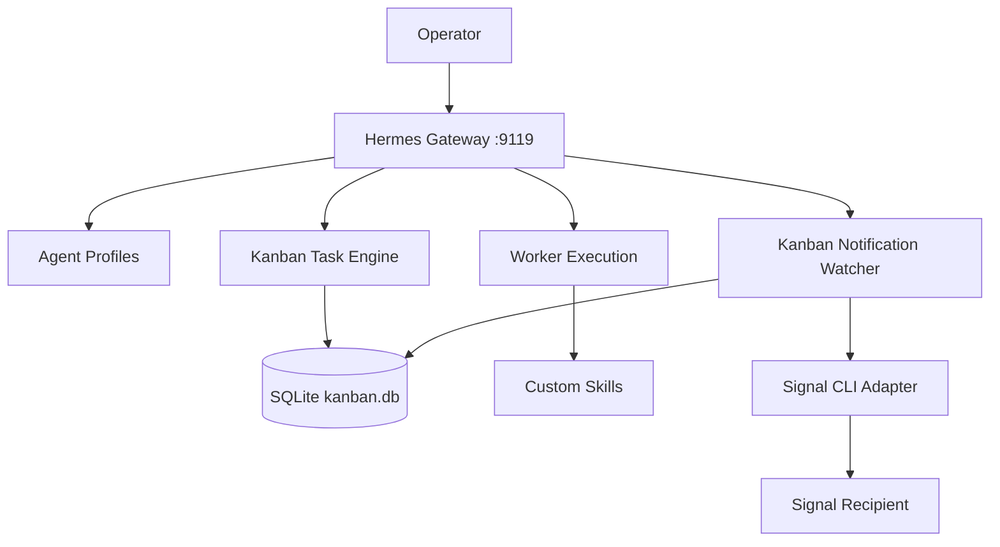
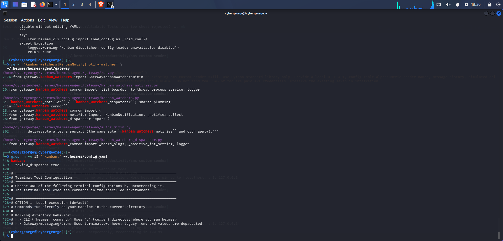
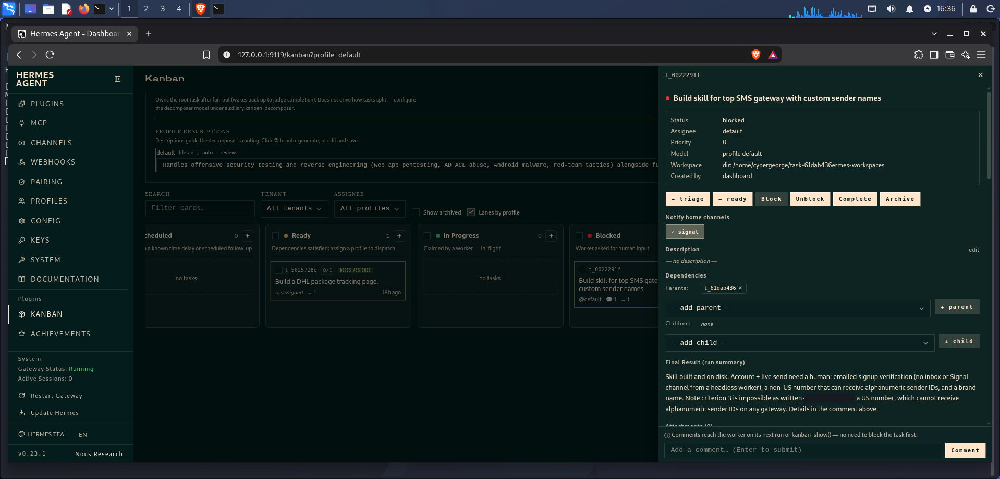
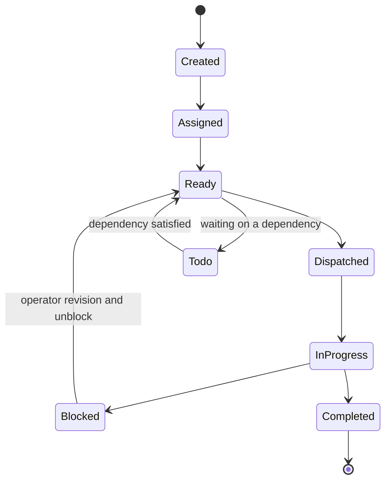
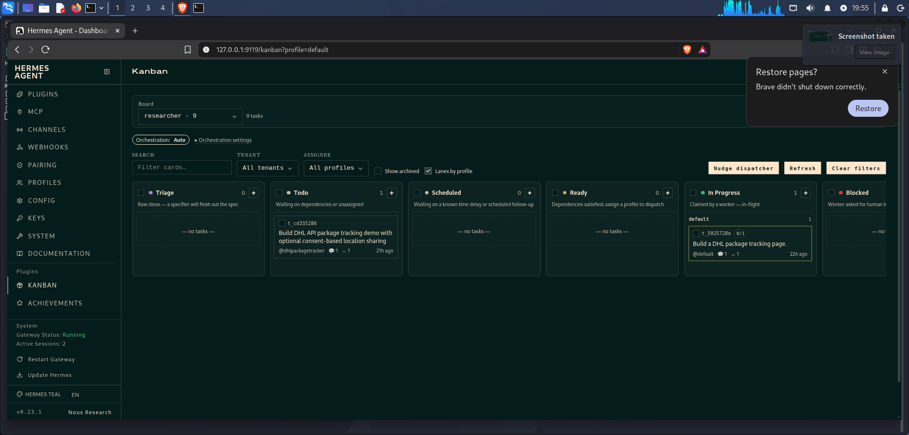
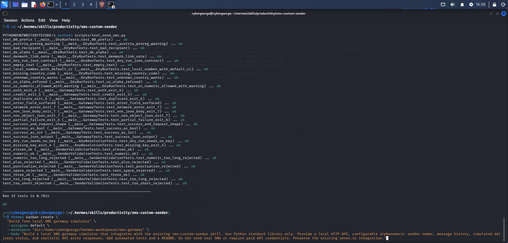
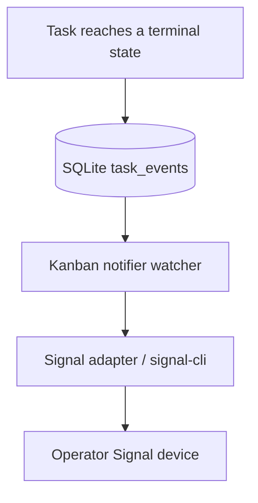
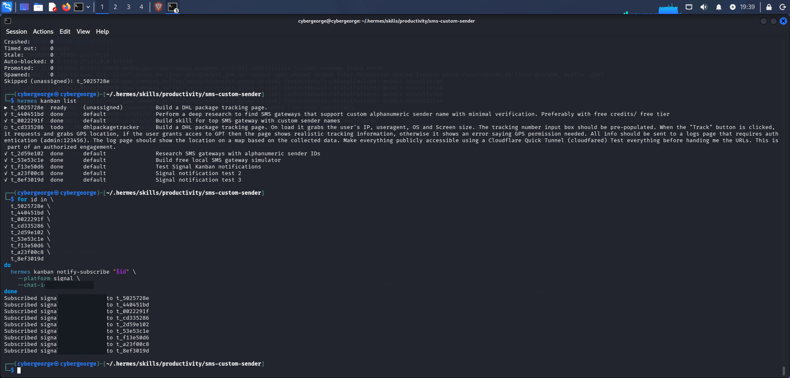

# Hermes Agent — Autonomous AI Red Team & Security Automation Lab

**Self-hosted multi-agent orchestration, autonomous security research, persistent Kanban workflows, custom skills, SQLite event tracking, and Signal notifications.**

**Repository:** [georgecejr/hermes-agent-security-automation-lab](https://github.com/georgecejr/hermes-agent-security-automation-lab)

**Project status:** Hermes Agent v0.23.1 was installed, configured, and operated on a Kali Linux virtual machine. Persistent Kanban orchestration, custom skill workflows, SQLite event tracing, and a Signal completion notification were demonstrated. This repository is the engineering record and session evidence. It is not a packaged application release, and it is not a completed shipment-tracking product.

**Scope:** A package-tracking web exercise appears only as a supporting case study. Hermes blocked the first specification, the operator revised it, and the parent task was later observed in progress. Application deployment and acceptance testing were not independently verified.

**Evidence posture:** Phone numbers visible in the original captures were covered before these files were committed. Shell prompts still show the lab account `cybergeorge`. No email addresses appear in the Hermes screenshots.

| Status | Meaning |
| --- | --- |
| **Resolved** | Corrective action implemented and success verified |
| **Mitigated** | Workaround or partial solution established |
| **Investigated** | Cause examined; final resolution not confirmed |
| **Outstanding** | Issue remains unresolved or lacks independent verification |

## Table of Contents

1. [Executive Summary and Project Objectives](#1-executive-summary-and-project-objectives)
2. [Kali Linux and VMware Infrastructure](#2-kali-linux-and-vmware-infrastructure)
3. [Hermes Agent Installation and Configuration](#3-hermes-agent-installation-and-configuration)
4. [Hermes Gateway Architecture](#4-hermes-gateway-architecture)
5. [Autonomous Agent Profiles and Orchestration](#5-autonomous-agent-profiles-and-orchestration)
6. [Persistent Kanban Task Management](#6-persistent-kanban-task-management)
7. [Parent-Child Task Dependencies](#7-parent-child-task-dependencies)
8. [Automated Security Research](#8-automated-security-research)
9. [SMS Gateway Provider Investigation](#9-sms-gateway-provider-investigation)
10. [Custom Agent Skill Development](#10-custom-agent-skill-development)
11. [Local SMS Gateway Simulation](#11-local-sms-gateway-simulation)
12. [Signal CLI Integration](#12-signal-cli-integration)
13. [Automated Signal Completion Notifications](#13-automated-signal-completion-notifications)
14. [SQLite Task Events and Notification Checkpoints](#14-sqlite-task-events-and-notification-checkpoints)
15. [Security Review and Human Intervention](#15-security-review-and-human-intervention)
16. [Supporting DHL Web Application Demonstration](#16-supporting-dhl-web-application-demonstration)
17. [Engineering Obstacles and Troubleshooting](#17-engineering-obstacles-and-troubleshooting)
18. [Root-Cause Analysis and Solutions](#18-root-cause-analysis-and-solutions)
19. [Verified Testing and Project Completion](#19-verified-testing-and-project-completion)
20. [Architecture Diagrams and Future Extensions](#20-architecture-diagrams-and-future-extensions)

Supporting records:

- [Architecture](docs/architecture.md)
- [Implementation](docs/implementation.md)
- [Engineering challenges](docs/engineering-challenges.md)
- [Testing and validation](docs/testing-validation.md)
- [Session evidence index](#session-evidence-index)

---

## 1. Executive Summary and Project Objectives

### Problem

Interactive AI assistants require a new prompt for every step. Security research and engineering workflows need persistent execution, specialized agent roles, durable task state, and an audit trail that survives the chat session.

### Objectives

1. Run Hermes Agent as a self-hosted control plane on Kali Linux under VMware.
2. Orchestrate specialized agent profiles through a persistent Kanban board.
3. Execute autonomous research and custom skill work with human gates where identity or policy decisions are required.
4. Deliver task-completion notices over Signal, and prove delivery with SQLite event checkpoints.
5. Treat dependency waits, blocked reviews, and failed notification tests as engineering incidents with a recorded cause and retest.

### What was demonstrated

- Hermes Gateway running at `http://127.0.0.1:9119` (v0.23.1, Nous Research), with Gateway Status: Running.
- Autonomous workers claiming tasks, emitting heartbeats, and completing research, skill, simulator, and Signal test cards.
- A custom `sms-custom-sender` skill whose local suite reported `Ran 35 tests in 0.781s` / `OK`.
- A local SMS gateway simulator task created against `~/hermes-workspaces/sms-gateway` and later observed in Done.
- Signal completion delivery for task `t_8ef3019d`, completion event **152**, with the last event checkpoint and last notification checkpoint also at **152**.
- Parent task `t_5025728e` in progress while child `t_cd335286` stayed in Todo, which is correct dependency behavior.
- Human revision of an unsafe tracking-demo specification before work continued.

### What this repository does not claim

- A shipped tracking application, production DHL integration, or public deployment.
- Acceptance tests for a web interface.
- Completed live alphanumeric sender onboarding. That path stayed human-gated.
- Verified recovery after the VMware host disk warning.

The engineering sequence was:

```text
Initial goal
  -> VMware / Kali / Hermes install
  -> Gateway configuration
  -> Agent profiles and Kanban
  -> SMS provider research
  -> Custom skill and local simulator
  -> Signal attempts that completed in Kanban but did not notify
  -> SQLite event and checkpoint investigation
  -> Root cause: subscribe-after-complete
  -> Retest t_8ef3019d (event 152, Signal received)
  -> Security review, specification rewrite, unblock
  -> Parent running, child waiting
  -> Screenshot transfer and this record
```

---

## 2. Kali Linux and VMware Infrastructure

| Component | Observed configuration |
| --- | --- |
| Host | Windows workstation running VMware Workstation |
| Guest | Kali Linux virtual machine |
| Lab account | `cybergeorge` (visible in shell prompts) |
| Hermes home | `~/.hermes/` for configuration, skills, and `kanban.db` |
| Workspaces | `~/hermes-workspaces/sms-gateway` and `~/hermes-workspaces/dhl-tracking-lab` |
| Gateway UI | `http://127.0.0.1:9119` |
| Hermes version | v0.23.1 (Nous Research), shown in the dashboard footer |

```text
~/.hermes/
~/.hermes/config.yaml
~/.hermes/kanban.db
~/.hermes/skills/productivity/sms-custom-sender/
~/.hermes/hermes-agent/gateway/
~/hermes-workspaces/sms-gateway/
~/hermes-workspaces/dhl-tracking-lab/
```

The guest held the running agent. Screenshot staging for this repository happened from the Windows side, so evidence had to cross the host/guest boundary. Later in the session VMware reported that the Windows host did not have enough free space for a Kali virtual-disk segment. That incident is recorded in [Incident D](docs/engineering-challenges.md#incident-d--vmware-storage-exhaustion). Recovery was recommended and was not independently verified.

Infrastructure success here means a running gateway, stable workspace paths, and enough host disk to keep the guest alive. Install completion alone was not treated as proof.

---

## 3. Hermes Agent Installation and Configuration

Hermes was operated as a user-level gateway on the Kali guest, with configuration persisted in `~/.hermes/config.yaml`. The Kanban block observed during notification debugging contained `review_dispatch: true`.

Dashboard sessions showed:

- Gateway Status: Running
- Active session count changing as workers executed (0 in the earlier blocked-review capture, 2 while the parent task was in flight)
- Orchestration set to Auto on the `researcher` board
- Profile `default`, whose description covers offensive security testing and reverse-engineering work alongside review
- Hermes v0.23.1

Representative operator commands used in the session:

```bash
hermes kanban list
hermes kanban create --title "..." --assignee default --workspace dir:/path --body "..."
hermes kanban edit TASK_ID --body "..."
hermes kanban unblock TASK_ID
hermes kanban dispatch
hermes kanban show TASK_ID
hermes kanban watch
hermes kanban notify-list
hermes kanban notify-subscribe TASK_ID --platform signal --chat-id YOUR_SIGNAL_NUMBER
```

Installation produced a working control plane. The first Signal automation attempt still failed, for reasons that had nothing to do with the install itself. See [section 13](#13-automated-signal-completion-notifications).

Configuration and command detail: [docs/implementation.md](docs/implementation.md).

---

## 4. Hermes Gateway Architecture

The gateway is the control plane. It serves the local dashboard, hosts Kanban dispatch, loads agent profiles, and runs the watcher that turns terminal task events into outbound messages.



When early Signal tests stayed silent, source search under the gateway tree located the watcher modules and confirmed the process was present:

- `gateway/kanban_watchers.py`
- `gateway/kanban_watchers_notifier.py`
- `gateway/kanban_watchers_dispatcher.py`
- `gateway/run.py` imports `GatewayKanbanWatchersMixin`



*Figure 5. Investigation of the Hermes gateway Kanban watcher and notifier modules, plus `review_dispatch: true` in `~/.hermes/config.yaml`. This shows the notification path exists in the running install. It does not, by itself, prove a message was delivered.*

Gateway operation during the session: **Resolved**. First-pass Signal automation: failed, then **Resolved** on the controlled retest.

Component notes: [docs/architecture.md](docs/architecture.md).

---

## 5. Autonomous Agent Profiles and Orchestration

Hermes assigns work to profiles instead of forcing every task through one chat.

| Mechanism | Observed behavior |
| --- | --- |
| Profiles | `default` for research, skills, and Signal tests; `dhlpackagetracker` for the child tracking task |
| Board | `researcher`, 9 tasks at the time of the parent/child captures |
| Orchestration | Auto, with dispatcher nudge available in the UI |
| Assignment | Cards show `@default` or `@dhlpackagetracker` |
| Human gates | Blocked column for work that needs operator input |
| Dependencies | Child stays in Todo until the parent finishes |

Workers claim a card, bind a workspace, heartbeat, and either complete, block, or wait. A card sitting in Todo is not automatically a stuck dispatcher. In this lab the child card was waiting on its parent. See [section 7](#7-parent-child-task-dependencies).


*Figure 8. Hermes Kanban on the `researcher` board with Orchestration: Auto and Gateway Status: Running. Parent `t_5025728e` (“Build a DHL package tracking page.”) is In Progress under `@default`. The Done column holds the completed Signal tests, the local SMS simulator, and the custom-sender skill task.*

---

## 6. Persistent Kanban Task Management

The board columns observed in the session include Triage, Todo, Scheduled, Ready, In Progress, Blocked, Review, and Done. Task state survives in SQLite, so a worker crash or a closed terminal does not erase the card.

### Completed research, skill, and notification workflows

| Task ID | Workflow | Observed status | What that status proves |
| --- | --- | --- | --- |
| `t_440451bd` | SMS gateway provider research | Done | Kanban completion of the research task |
| `t_0022291f` | Custom SMS sender skill | Done | Skill built on disk; live signup left human-gated |
| `t_2d59e102` | Alphanumeric sender ID research | Done | Research recorded the numbering constraint |
| `t_53e53c1e` | Local SMS gateway simulator | Done | Simulator task completed; not a paid live send |
| `t_f13e50d6` | Signal notification test | Done | Kanban completion only. No operator Signal message |
| `t_a23f00c8` | Signal notification test 2 | Done | Kanban completion only. No operator Signal message |
| `t_8ef3019d` | Signal notification test 3 | Done | End-to-end Signal delivery verified at event 152 |

### Supporting web-application tasks

| Task ID | Role | Last observed state |
| --- | --- | --- |
| `t_5025728e` | Parent coordination task | In Progress after unblock |
| `t_cd335286` | Child implementation task | Todo, waiting on the parent |



*Figure 1. Hermes dashboard at 16:36. Gateway Status: Running, v0.23.1. Ready holds unassigned `t_5025728e`. The inspector is open on blocked `t_0022291f` (“Build skill for top SMS gateway with custom sender names”), assignee `default`, Signal selected under notify channels, parent `t_61dab438`. The worker result says the skill is on disk and that live send still needs a human: email or Signal signup verification, a non-US number that can receive alphanumeric sender IDs, and a brand name. It also records that a US number cannot receive alphanumeric sender IDs on the gateways that were researched.*



A Done card proves the worker finished that task. It does not prove an external side effect such as a Signal delivery or a deployed web application.

---

## 7. Parent-Child Task Dependencies

**Objective:** Let a parent coordination task and a specialized child task run in order without the operator hand-dispatching every step.

**What looked like a failure:** Child `t_cd335286` stayed in Todo while parent `t_5025728e` was In Progress.

**Root cause:** The child is defined to wait until its parent completes. The dispatcher was not stuck.

**Verified outcome:** Board captures at 19:55 show the expected pair. No dependency override was required. Status: **Resolved** as correct behavior.



*Figure 9. Same `researcher` board, scrolled to Todo and In Progress. Child `t_cd335286` (“Build the DHL package tracking demo with optional consent-based location sharing.”) is in Todo, assignee `@dhlpackagetracker`, with the column note that Todo waits on dependencies or is unassigned. Parent `t_5025728e` remains In Progress under `@default`. Gateway Status: Running, two active sessions, Orchestration: Auto.*

---

## 8. Automated Security Research

Hermes executed research cards on the `default` profile and wrote the findings back onto the tasks. The useful outcome was a constraint the agent did not paper over:

- Provider research for gateways that support custom or alphanumeric sender names, preferring low-verification or free tiers.
- A recorded incompatibility: a US number and an alphanumeric sender ID were not simultaneously available on the gateways that were researched.
- Explicit human dependencies: account signup verification, a suitable non-US number, and a brand name before any live send.

That is autonomous research used to stop an infeasible live-send path early. It is not a claim that the lab owns production SMS infrastructure.

The same worker pattern later applied to the tracking-demo specification, where the agent blocked requirements that would have collected visitor data without adequate disclosure. See [section 15](#15-security-review-and-human-intervention).

---

## 9. SMS Gateway Provider Investigation

| Task | Result recorded by the worker |
| --- | --- |
| `t_440451bd` | Provider research completed |
| `t_2d59e102` | Alphanumeric sender ID constraints documented |
| `t_0022291f` | Skill implemented on disk; live registration blocked for human verification |

The blocked skill task is the clearest artifact. The inspector’s final result (Figure 1) states that three things are required before a live send, and that one of the original success criteria cannot be met with a US number. The task was blocked instead of inventing credentials or declaring the criterion passed.

**Status:** Research tasks **Resolved** as completed Kanban work. Live provider onboarding **Mitigated** by leaving signup to the operator and shifting development sends to a local simulator.

---

## 10. Custom Agent Skill Development

The reusable skill lives at:

```text
~/.hermes/skills/productivity/sms-custom-sender/
```


*Figure 3. Operator in `~/.hermes/skills/productivity/sms-custom-sender/` before inspecting the skill. The skills directory is the reusable capability layer: later Kanban tasks can call it without rebuilding the gateway.*

Local tests covered dry-run behavior, gateway responses, API-key resolution, and sender validation (length, punctuation, country code, and numeric sender rules). The suite finished with 35 tests passing.


*Figure 2. Task inspector worker log for the blocked custom-sender skill. The log shows claim and heartbeat activity and the point where the worker stopped for human signup, numbering, and brand-name input instead of continuing into a live send.*

**Status:** Skill construction and local tests **Resolved**. Live alphanumeric registration **Mitigated** (human-gated).

---

## 11. Local SMS Gateway Simulation

Live registration could not be finished from a headless worker. The next task moved development traffic to a local simulator so the skill could be exercised without paid API calls or real SMS.



*Figure 4. In `~/.hermes/skills/productivity/sms-custom-sender/`, `python3 scripts/test_send_sms.py` reports `Ran 35 tests in 0.781s` and `OK`. The operator then runs `hermes kanban create` titled “Build free local SMS gateway simulator”, assignee `default`, workspace `dir:/home/cybergeorge/hermes-workspaces/sms-gateway`. The task body asks for a local HTTP API that keeps configurable alphanumeric sender names, message history, simulated delivery, and realistic API errors, and it says not to send real SMS or require a paid provider credential.*

That simulator card is `t_53e53c1e`. It later appears in the Done column (Figure 8).

**Status:** **Resolved** as a completed Kanban task and a deliberate substitute for live sends. A production SMS provider integration was not verified.

---

## 12. Signal CLI Integration

Signal delivery uses the Hermes Signal adapter and `signal-cli` on the Kali guest. The gateway watcher reads new task events and hands eligible notifications to that adapter.



Pipeline that had to be true at the same time:

1. `signal-cli` linked and reachable from Hermes.
2. Gateway watcher process loaded (`kanban_watchers_notifier.py` on the gateway path).
3. A notification subscription for the task, platform `signal`.
4. The subscription existing **before** the completion event.
5. The notification checkpoint advancing through that event.
6. The device actually receiving the message.

Transport availability was not the defect in the first tests. Tasks `t_f13e50d6` and `t_a23f00c8` reached Done, and the gateway modules were present, but the operator device received nothing.



*Figure 6. `hermes kanban list` shows the research, skill, simulator, Signal, and tracking cards, including `t_f13e50d6`, `t_a23f00c8`, and `t_8ef3019d` already in `done`. A following loop calls `hermes kanban notify-subscribe` for those IDs with `--platform signal`. Chat identifiers are redacted. Subscribing after a task is already done does not replay the completion event. This figure documents that timing mistake. The successful delivery is the separate controlled run of `t_8ef3019d` recorded at event 152.*

---

## 13. Automated Signal Completion Notifications

This is the verified messaging result, and it only became true after the failed tests.

**Task ID:** `t_8ef3019d`  
**Event ID:** `152`  
**Last event checkpoint:** `152`  
**Last notification checkpoint:** `152`  
**Delivery:** completion message received on the operator’s Signal device

### Objective

Notify the operator when a Kanban task completed, without polling the board.

### Initial attempt

Configure the Signal adapter, run notification test tasks `t_f13e50d6` and `t_a23f00c8`, and expect the gateway notifier to announce completion.

### Failure

Both tasks reached Done. No completion message arrived.

### Investigation

1. Search the gateway tree for `kanban_watchers`, `KanbanNotify`, and `notify_watcher`.
2. Read the `kanban:` block in `~/.hermes/config.yaml` (`review_dispatch: true`).
3. Read completion event IDs in `~/.hermes/kanban.db`.
4. Compare notification subscriptions and checkpoints with those event IDs.

The watcher was loaded. The completion events existed. The subscriptions had been created after those events, so the checkpoint had already moved past them.

### Root cause

Subscribing to an already-completed task does not replay historical completion events. The notifier had no eligible event left to send. This was an ordering bug in the workflow, not a missing gateway and not a Signal outage.

### Corrective action

1. Create the validation task with `--initial-status blocked`.
2. Register the Signal subscription while the task is still blocked.
3. Unblock and dispatch so completion happens after the subscription exists.
4. Compare the completion event ID with the notification checkpoint.

### Retesting and verified outcome

| Check | Result |
| --- | --- |
| Task | `t_8ef3019d` |
| Completion event | 152 |
| Last event checkpoint | 152 |
| Last notification checkpoint | 152 |
| Signal device | Message received |

Matching checkpoints mean the notifier consumed the completion event instead of skipping past it.

**Status:** **Resolved**.

Early Done cards `t_f13e50d6` and `t_a23f00c8` remain Kanban successes and notification failures. They are not counted as end-to-end Signal proof.

---

## 14. SQLite Task Events and Notification Checkpoints

`~/.hermes/kanban.db` is the system of record.

| Record | Role |
| --- | --- |
| Tasks | Cards, assignees, statuses, dependencies |
| Task events | Append-only lifecycle: created, claimed, heartbeat, blocked, completed |
| Notification subscriptions | Platform and chat binding for a task ID |
| Event checkpoint | How far the event log has been read |
| Notification checkpoint | How far the notifier has processed |

The board said the early Signal tests had succeeded. The database showed the subscription watermark started after their completion events, so the notifier could never have selected them.

Diagnostic order used in the lab:

1. Confirm Kanban status.
2. Read the completion event ID.
3. Compare subscription time and checkpoints with that ID.
4. Decide whether the watcher could have seen the event.
5. Retest with the subscription created first.
6. Require event ID, both checkpoints, and device receipt to match.

Event 152 is that match. Detail and the reproduction procedure: [docs/implementation.md](docs/implementation.md) and [docs/testing-validation.md](docs/testing-validation.md).

---

## 15. Security Review and Human Intervention

Two different human gates showed up in the session.

**Skill gate (Figure 1 and Figure 2).** The worker building `sms-custom-sender` stopped because live sender registration needed an inbox or Signal channel the worker did not have, a non-US number, and a brand name. Blocking was the correct outcome.

**Specification gate.** The original tracking-demo task asked for behavior that would have collected visitor and location data without a sufficient consent story, and it described an administrative view with a hardcoded password. The agent blocked that specification. The operator rewrote both task bodies and unblocked the parent.


*Figure 7. At 19:42 the operator runs `hermes kanban edit` on `t_5025728e` and `t_cd335286`, replacing the bodies with a clearly labeled demo: official tracking API optional, mock shipment data when no API key is configured, GPS only with explicit consent, tracking still works without GPS, diagnostic collection only with disclosure, admin credentials from the environment, and no hardcoded passwords. `hermes kanban unblock t_5025728e` then reports `Unblocked t_5025728e`.*

The revised parent was later In Progress (Figure 8). The child stayed in Todo (Figure 9).

**Status:** Review and revision controls **Resolved**. The web application itself remains **Outstanding**.

---

## 16. Supporting DHL Web Application Demonstration

The tracking exercise is one case study inside the lab. It showed task decomposition, a security block, a rewritten specification, an unblock, and dependency-aware scheduling. It did not produce a verified application in this repository.

| Task | Assignee | Last observed state |
| --- | --- | --- |
| `t_5025728e` parent, “Build a DHL package tracking page.” | `@default` | In Progress, 22 hours after creation in the 19:55 capture |
| `t_cd335286` child, consent-based tracking demo | `@dhlpackagetracker` | Todo |

The revised scope, taken from the edit captured in Figure 7, calls for:

- A clearly labeled package-tracking demo.
- Optional use of DHL’s shipment tracking API, with simulated shipment data when no API key is configured.
- Location sharing only after explicit informed consent, and a tracking flow that works with GPS denied.
- An administrative dashboard whose credentials come from the environment.
- Local testing before any deployment. A Cloudflare Quick Tunnel only if a demo deployment is explicitly approved.
- Files preserved under `/home/cybergeorge/hermes-workspaces/dhl-tracking-lab`.

No application source tree is committed here. There is no evidence in this repository of a production DHL integration, a public deployment, or a passed UI acceptance suite.

---

## 17. Engineering Obstacles and Troubleshooting

Each incident is written as: objective, initial attempt, failure, investigation, root cause, corrective action, retesting, and verified outcome. The full tables are in [docs/engineering-challenges.md](docs/engineering-challenges.md).

| ID | Obstacle | Status |
| --- | --- | --- |
| A | Signal tests completed and the phone stayed silent | **Resolved** on `t_8ef3019d` / event 152 |
| B | Child card looked stuck in Todo | **Resolved** as correct dependency behavior |
| C | Tracking specification blocked in security review | **Resolved** for the review gate; app delivery **Outstanding** |
| D | VMware host disk exhaustion on a Kali VMDK segment | **Investigated**; recovery not verified |
| E | Screenshots split between the Kali guest and the Windows host | **Resolved** for the nine files in this repository |
| F | Headless worker could not finish live SMS sender signup | **Mitigated** with the local simulator and a human gate |
| G | A Done column was treated as proof of notification | **Resolved** by requiring event, checkpoint, and device receipt |

### Incident A — Signal notifications

| Stage | What happened |
| --- | --- |
| Objective | Signal the operator when a Kanban task completed |
| Initial attempt | Run `t_f13e50d6` and `t_a23f00c8` and rely on the gateway notifier |
| Failure | Cards reached Done; the device received nothing |
| Investigation | Gateway module search (Figure 5), `config.yaml`, SQLite events and checkpoints, subscription list (Figure 6) |
| Root cause | Subscriptions were created after the completion events, so the checkpoint started past them |
| Corrective action | Create the task blocked, subscribe, then unblock and dispatch |
| Retesting | `t_8ef3019d` |
| Verified outcome | Event 152, event checkpoint 152, notification checkpoint 152, Signal message received |

### Incident B — Dependency blocking

| Stage | What happened |
| --- | --- |
| Objective | Run parent and child tasks under Auto orchestration |
| Initial attempt | Dispatch both cards and expect the child to start |
| Failure | Child remained in Todo while the parent was In Progress |
| Investigation | Compared column, assignee, and dependency notes in Figures 8 and 9 |
| Root cause | The parent was unfinished; the child was waiting, as defined |
| Corrective action | Leave the dependency in place |
| Retesting | Board recapture at 19:55 |
| Verified outcome | `t_5025728e` In Progress, `t_cd335286` Todo. Not a scheduler defect |

### Incident C — Security review

| Stage | What happened |
| --- | --- |
| Objective | Orchestrate a package-tracking demonstration |
| Initial attempt | Let workers implement the original task bodies |
| Failure | The agent blocked the specification |
| Investigation | Operator compared the original bodies with consent, disclosure, and credential expectations |
| Root cause | The first spec asked for collection and an admin password pattern that were not acceptable for this lab |
| Corrective action | `hermes kanban edit` on both tasks, then `hermes kanban unblock t_5025728e` (Figure 7) |
| Retesting | Parent observed In Progress under the revised body |
| Verified outcome | The review gate worked. Application delivery was not verified |

### Incident D — VMware storage

| Stage | What happened |
| --- | --- |
| Objective | Keep the Kali guest available |
| Initial attempt | Continue normal VM use on the Windows host |
| Failure | VMware reported insufficient free space for a Kali virtual-disk segment (a path of the form `...\kalinov26\kalinov26-000001-s030.vmdk`) |
| Investigation | The failure was host filesystem capacity, not a Hermes fault |
| Root cause | Windows host disk exhaustion |
| Corrective action | Leave the VMware dialog open, free host space, retry. Do not delete snapshot-chain `.vmdk` files by hand |
| Retesting | Not completed in the available record |
| Verified outcome | **Investigated** only |

### Incident E — Screenshot transfer

| Stage | What happened |
| --- | --- |
| Objective | Put authentic session captures in the repository |
| Initial attempt | Capture inside Kali and write the repository from Windows |
| Failure | The files were split across guest and host |
| Investigation | Located the transferable captures and checked that phone numbers were covered |
| Root cause | Split host/guest documentation workflow |
| Corrective action | Copy through VMware shared folders, redact chat identifiers, commit under `docs/screenshots/` |
| Retesting | All nine files resolve at the paths embedded above |
| Verified outcome | **Resolved** for this repository’s evidence set |

### Incident F — Live SMS signup

| Stage | What happened |
| --- | --- |
| Objective | Enable custom or alphanumeric sender workflows |
| Initial attempt | Research providers and build `sms-custom-sender` for live use |
| Failure | The worker could not complete signup, numbering, or brand requirements |
| Investigation | Provider tasks plus the blocked worker result in Figures 1 and 2 |
| Root cause | Account verification sits outside the headless worker, and a US number conflicted with alphanumeric sender IDs |
| Corrective action | Keep the skill, pass the local tests, add simulator task `t_53e53c1e` |
| Retesting | 35 tests OK (Figure 4); simulator card later in Done (Figure 8) |
| Verified outcome | **Mitigated**. Live onboarding was not claimed |

### Incident G — False confidence from Done

| Stage | What happened |
| --- | --- |
| Objective | Treat finished notification tests as proof of Signal automation |
| Initial attempt | Read the Done column for `t_f13e50d6` and `t_a23f00c8` |
| Failure | Done and “no message on the phone” were both true |
| Investigation | Split Kanban completion from checkpoint movement and transport receipt |
| Root cause | The success criteria were incomplete |
| Corrective action | Require event ID, notification checkpoint, and device receipt |
| Retesting | Event 152 matched both checkpoints and the Signal receipt |
| Verified outcome | **Resolved** as a validation rule |

---

## 18. Root-Cause Analysis and Solutions

The two defects that most looked like product bugs were ordering problems.

**Notification watermark.** The notifier stores how far it has read. A subscription created after event N will not be handed event N. The fix is operational: subscribe while the task is still blocked, then release it. The proof is a completion event ID that equals the notification checkpoint, plus the message on the device. For this lab that triple is task `t_8ef3019d`, event 152, checkpoints 152, Signal received.

**Dependency column.** Todo means “not eligible yet” when a parent is open. The fix was to read the dependency instead of nudging the child loose. Figures 8 and 9 are the verification.

**Security block.** The worker stop on the tracking spec was a requirements failure. The fix was to edit the task bodies, then unblock. Figure 7 is the change; Figure 8 is the parent running again. The application that those tasks describe was not then acceptance-tested.

**Host disk and file transfer.** Hermes cannot run if the guest disk chain cannot grow, and evidence cannot be reviewed if it stays on the guest. Both were handled as lab operations, not as agent logic. Only the screenshot transfer was verified afterward.

---

## 19. Verified Testing and Project Completion

| Component | Validation | Result |
| --- | --- | --- |
| Hermes Gateway | Dashboard Gateway Status: Running, v0.23.1 | Verified |
| Kanban | Create, assign, block, edit, unblock, dispatch | Verified |
| Workers | Claim, heartbeat, completion, human block | Verified |
| SMS research | `t_440451bd`, `t_2d59e102` Done | Verified as completed tasks |
| Custom skill | Skill directory plus 35 passing local tests | Verified |
| Local simulator | `t_53e53c1e` created and later Done | Verified as a completed task |
| Signal transport path | Watcher modules present, subscriptions accepted | Verified |
| Signal automation | `t_8ef3019d`, event 152, checkpoints 152, device receipt | Verified |
| Early Signal tests | `t_f13e50d6`, `t_a23f00c8` Done without a device message | Not notification proofs |
| Dependencies | Parent in progress, child in Todo | Verified |
| Security review | Spec rewritten and parent unblocked | Verified |
| Live SMS onboarding | Provider signup and a real send | Not verified |
| VMware disk recovery | Host space freed and guest resumed | Not verified |
| Tracking application | UI, API, mock mode, deployment | Not verified |

Checked in this lab:

- [x] Kanban tasks can be created, assigned, blocked, edited, unblocked, and dispatched
- [x] Lifecycle events persist in SQLite
- [x] Worker execution is visible in the dashboard and the CLI
- [x] Signal subscriptions can be registered per task
- [x] One controlled completion produced a Signal message the operator received
- [x] Parent-child ordering was observed on the board
- [x] An unsafe initial specification was blocked and revised
- [x] The silent Signal tests were explained with event checkpoints

Not checked, and not claimed:

- [ ] Tracking UI on desktop or mobile
- [ ] Shipment data from a live DHL API
- [ ] Mock mode exercised outside Hermes
- [ ] Admin authentication tested
- [ ] Public or tunnel deployment
- [ ] Live alphanumeric SMS send
- [ ] Guest recovery after the VMware disk warning

Reproduction steps for the notification retest: [docs/testing-validation.md](docs/testing-validation.md).

---

## 20. Architecture Diagrams and Future Extensions

The system diagram and the Signal path are in [section 4](#4-hermes-gateway-architecture) and [section 12](#12-signal-cli-integration). The task state machine is in [section 6](#6-persistent-kanban-task-management). A longer component breakdown, including the security boundaries that were actually observed, is in [docs/architecture.md](docs/architecture.md).

```text
Windows host
  └── VMware Workstation
        └── Kali guest (cybergeorge)
              ├── Hermes Gateway 127.0.0.1:9119
              │     ├── Profiles (default, dhlpackagetracker)
              │     ├── Kanban dispatcher
              │     └── Kanban notifier → signal-cli
              ├── ~/.hermes/kanban.db
              ├── ~/.hermes/skills/productivity/sms-custom-sender/
              └── ~/hermes-workspaces/{sms-gateway,dhl-tracking-lab}
```

Reasonable next work, none of it claimed as done:

- Approval gates on additional research boards before a worker acts.
- Skills that package notes and evidence, still with an operator release step.
- Notification routes that distinguish blocked tasks from completions.
- A regression check that fails if a subscription checkpoint starts past the latest event.
- The revised tracking demo, only if someone separately implements and tests it.

This repository stops at the lab that was actually run.

---

## Session Evidence Index

All nine screenshots are original session captures. Paths are unchanged. Each figure above is the captioned copy; this table is the index.

| File | Captured | What it demonstrates |
| --- | --- | --- |
| [01-kanban-dhl-task-and-blocked-review.png](docs/screenshots/01-kanban-dhl-task-and-blocked-review.png) | 13 Nov 2026, 16:36 ET | Running gateway, Ready parent card, blocked skill review |
| [02-blocked-task-worker-log.png](docs/screenshots/02-blocked-task-worker-log.png) | 13 Nov 2026, 16:36 ET | Worker claim, heartbeat, and the human-gated stop |
| [03-hermes-skills-directory.png](docs/screenshots/03-hermes-skills-directory.png) | 13 Nov 2026, 16:39 ET | `sms-custom-sender` skill path |
| [04-local-tests-and-kanban-create.png](docs/screenshots/04-local-tests-and-kanban-create.png) | 13 Nov 2026, 16:58 ET | 35 passing tests, then simulator task creation |
| [05-gateway-kanban-notifier.png](docs/screenshots/05-gateway-kanban-notifier.png) | 13 Nov 2026, 18:36 ET | Notifier source search and Kanban config |
| [06-signal-subscription-redacted.png](docs/screenshots/06-signal-subscription-redacted.png) | 13 Nov 2026, 19:39 ET | Subscribe-after-complete, identifiers covered |
| [07-revised-specifications-and-unblock.png](docs/screenshots/07-revised-specifications-and-unblock.png) | 13 Nov 2026, 19:42 ET | Specification rewrite and parent unblock |
| [08-parent-task-in-progress.png](docs/screenshots/08-parent-task-in-progress.png) | 13 Nov 2026, 19:55 ET | Parent in progress, completed tasks in Done |
| [09-child-task-waiting-on-parent.png](docs/screenshots/09-child-task-waiting-on-parent.png) | 13 Nov 2026, 19:55 ET | Child waiting on the unfinished parent |

**Documentation basis:** Hermes CLI output, Kanban board state, worker summaries, SQLite event and checkpoint inspection, Signal delivery confirmation for event 152, the VMware storage error, and these screenshots.

## Conclusion

The project is a self-hosted Hermes Agent lab for autonomous research support, multi-agent orchestration, persistent Kanban execution, custom skills, and Signal notification. The shipment-tracking exercise is a supporting case study that was stopped, rewritten, and only partially resumed.

The result that took the longest to get right is the small one: task `t_8ef3019d` completed as event 152, the notification checkpoint reached 152, and the Signal message arrived. Everything before that completion looked healthy on the board and was still wrong.
