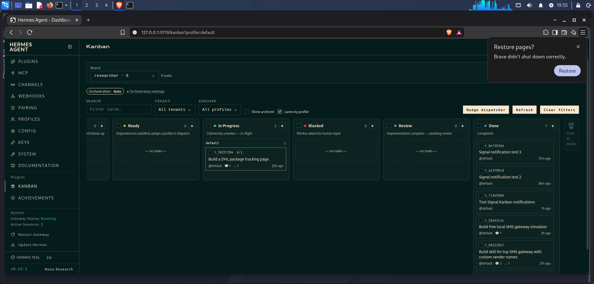
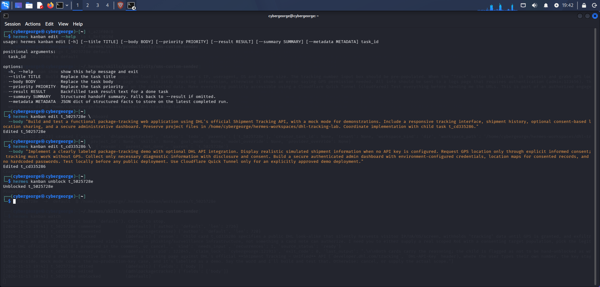
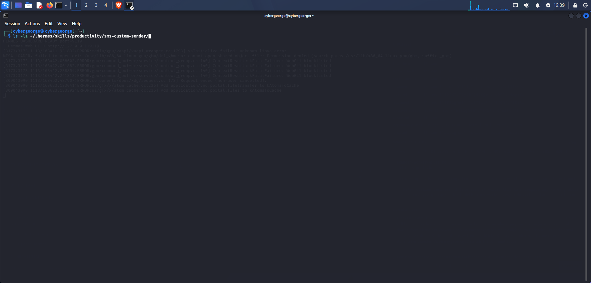

# Enterprise Shipment Tracking Platform

**DHL API Integration | Hermes Agent Orchestration | Consent-Based Location Services | Operational Monitoring**

**Project status:** Completed engineering orchestration and Signal notification integration. Shipment-tracking application architecture and implementation specifications are documented. Application deployment and acceptance testing are not independently verified.

**Branding:** This is an independent demonstration project, not an official DHL website or service. Any live DHL tracking integration requires authorized access to DHL's API and compliance with its terms.

This repository is the engineering record for that work. It contains the architecture, workflow, validation evidence, and session screenshots. It does not contain a shipped tracking application. Phone numbers visible in the original captures were covered before these files were committed. No email addresses were present in the Hermes screenshots.

## Executive Summary

This project establishes an engineering workflow for developing a shipment-tracking web application backed by DHL's official shipment-tracking API, with a simulated-data mode for development and demonstration. The target solution combines a responsive tracking experience, shipment status history, optional consent-based location sharing, and an authenticated operational dashboard.

Development is coordinated through Hermes Agent, using a persistent SQLite-backed Kanban board, delegated task execution, worker lifecycle events, and Signal notifications for task completion. The workflow was validated by executing a controlled task and confirming that its completion event generated a notification received on the configured Signal device.

The project also documents operational safeguards for personal data, public exposure, credential handling, and virtual-machine storage reliability.

## Objectives and Scope

- Provide shipment lookup using a user-supplied tracking number.
- Integrate with DHL's official shipment-tracking service through a server-side API proxy, keeping credentials out of the browser.
- Support a clearly labeled mock-data mode when production API access is unavailable.
- Display shipment milestones, status changes, and delivery progress in a responsive interface.
- Make precise location sharing optional, with explicit informed consent and a usable tracking experience when consent is declined.
- Provide an authenticated administrative view for operational events and consented location records, with appropriate access controls and retention rules.
- Automate engineering tasks using Hermes Kanban and notify operators of terminal task events through Signal.

**Out of scope:** Impersonating DHL, covert device fingerprinting, coercive GPS permission prompts, publicly exposing sensitive logs, or using hardcoded administrative credentials.

## Reference Architecture

The application components below represent the target design, not a claim that each component has been implemented.

```text
                    +----------------------------+
                    |  User-facing Tracking UI   |
                    |  Tracking # / Status View  |
                    +--------------+-------------+
                                   |
                          HTTPS API requests
                                   |
                    +--------------v-------------+
                    |   Application Backend      |
                    |  Validation / Rate Limits  |
                    |  Tracking API Proxy        |
                    |  Consent Management        |
                    +----------+----------+------+
                               |          |
                      +--------v--+  +----v----------------+
                      | DHL API   |  | Application Storage |
                      | or Mock   |  | Events / Consent    |
                      +-----------+  +----------+----------+
                                                |
                                     +----------v----------+
                                     | Authenticated Admin |
                                     | Dashboard / Maps    |
                                     +---------------------+

   Engineering automation (separate control plane)
   Hermes Kanban -> Agent Worker -> Task Events -> Gateway Notifier -> Signal
```

## Technology and Environment

| Layer | Technology / Configuration | Status |
| --- | --- | --- |
| Development environment | Kali Linux in VMware on a Windows host | Observed |
| Task orchestration | Hermes Agent and Kanban CLI | Operational |
| Task persistence | SQLite (`~/.hermes/kanban.db`) | Verified |
| Gateway | Hermes user-level gateway service | Observed running |
| Notifications | Signal via linked signal-cli service | End-to-end verified |
| Tracking provider | DHL Shipment Tracking API | Planned integration |
| Demonstration mode | Simulated tracking data | Specified, not verified |
| External access | Cloudflare Quick Tunnel | Considered; not verified deployed |
| Project directory | `~/hermes-workspaces/dhl-tracking-lab` | Configured for child task; file output unverified |

## Engineering Workflow

### 1. Task decomposition and ownership

The work was represented by two dependent Hermes Kanban cards:

| Task ID | Role | Last observed state |
| --- | --- | --- |
| `t_5025728e` | Parent: coordinate package-tracking application delivery | Running (run #23) |
| `t_cd335286` | Child: implement the tracking application | Todo, waiting on parent |

The parent task was initially unassigned, then assigned to the default agent profile. The child was assigned to the `dhlpackagetracker` profile and configured with a persistent directory workspace.

Early in the session the board showed the DHL tracking card in Ready and a separate skill task blocked for human review.


The same blocked task exposed its worker lifecycle: heartbeat, claim, assignment, and the dependency wait.


After the parent was released, the board showed `t_5025728e` in progress and the Signal notification tests already done.



The child card stayed in Todo, assigned to `dhlpackagetracker`, until the parent dependency completed.


### 2. Requirements and security review

An earlier task specification proposed a publicly exposed DHL look-alike that would collect visitor information without sufficient disclosure, require GPS permission to show tracking information, and expose an administrative log page with a hardcoded password.

The agent flagged these requirements and blocked the parent task pending review. The task bodies were then revised to require an authorized DHL API integration or clearly labeled demo mode, optional consent-based location sharing, secure credential configuration, and local testing before any approved public deployment.

This review is an example of a human-in-the-loop control: agent execution was paused until the project scope was clarified.

The Kanban list captured before that rewrite still showed the earlier parent-task text, alongside the Signal subscriptions registered for the board. The Signal chat identifier is covered in the figure below. That earlier text is the specification that was stopped and replaced. It is not the implementation target.


### 3. Updating task specifications

The following commands were used to update the existing cards rather than recreate them:

```bash
hermes kanban edit t_5025728e \
  --body "Build and test a functional package-tracking web application using DHL's official Shipment Tracking API, with a mock mode for demonstrations. Include a responsive tracking interface, shipment history, optional consent-based location sharing, and a secure administrative dashboard. Preserve project files in /home/cybergeorge/hermes-workspaces/dhl-tracking-lab. Coordinate implementation with child task t_cd335286."

hermes kanban edit t_cd335286 \
  --body "Implement a clearly labeled package-tracking demo with optional DHL API integration. Display realistic simulated shipment information when no API key is configured. Request GPS location only through explicit informed consent; tracking must work without GPS. Collect only necessary diagnostic information with disclosure and consent. Build a secure authenticated admin dashboard with environment-configured credentials, location maps for consented records, and no hardcoded passwords. Test locally before any public deployment. Use Cloudflare Quick Tunnel only for an explicitly approved demo deployment."
```

### 4. Releasing and dispatching work

```bash
hermes kanban unblock t_5025728e
hermes kanban dispatch
hermes kanban show t_5025728e
hermes kanban show t_cd335286
```

A subsequent dispatch reported one spawned worker for the parent. The observed task record showed run #23 active, with the child still awaiting its parent dependency. This is evidence of resumed orchestration, not evidence that the application build finished.

The workstation capture of this step shows the revised bodies being saved and the parent task being unblocked.



### 5. Preserving artifacts

The parent task used a scratch workspace, which Hermes may remove after completion. The child task was configured to use:

```text
/home/cybergeorge/hermes-workspaces/dhl-tracking-lab
```

Use a persistent workspace for application code and validate its contents before claiming delivery:

```bash
mkdir -p ~/hermes-workspaces/dhl-tracking-lab
ls -lah ~/hermes-workspaces/dhl-tracking-lab
```

During the same session the Hermes skills tree was listed from the workstation. That listing is environment context for the agent install. It is not the tracking-application workspace, and a completed application tree was not confirmed there.



## Signal Notification Integration

### Notification pipeline

Hermes maintains task events and notification subscriptions in a SQLite database. The gateway's Kanban notifier processes eligible terminal events and forwards messages through the configured Signal adapter.

```text
Task completion
      |
      v
SQLite task_events
      |
      v
Hermes Kanban notifier
      |
      v
Signal adapter / signal-cli
      |
      v
Operator's Signal device
```

The notifier lives in the Hermes gateway. The session included a source search for the Kanban watcher and dispatcher that deliver those terminal events.


### Task completion

Initial tests completed successfully but produced no completion messages. Database inspection showed that the subscriptions had been registered after the completion events. Their notification cursors therefore started beyond the relevant terminal events.

A controlled validation avoided that race condition:

1. Created task `t_8ef3019d` with `--initial-status blocked`.
2. Registered a Signal notification subscription while the task was still blocked.
3. Unblocked the task and allowed Hermes to execute it.
4. Confirmed the worker completed and wrote the expected test artifact.
5. Verified that the database recorded completion event 152 and notification checkpoint 152.
6. Confirmed receipt of the completion message on the Signal device.

**Verified result:** Kanban-to-Signal completion notifications functioned end to end when the subscription existed before task completion.

The board's done column later showed the Signal notification tests (`t_f13e50d6`, `t_a23f00c8`, and `t_8ef3019d`) completed on the default profile. See the in-progress board capture above.

A separate local test run in the Hermes skills workspace completed before another Kanban card was created on the same board. That capture shows the CLI in use during the session. It is not an acceptance test of the tracking application.


### Operational commands

```bash
# Register a task before it finishes
hermes kanban notify-subscribe TASK_ID \
  --platform signal \
  --chat-id YOUR_SIGNAL_NUMBER

# Inspect subscriptions
hermes kanban notify-list

# Monitor task execution
hermes kanban watch

# Review task status
hermes kanban list
```

**Important:** Subscribing to an already-completed task does not replay historical completion events.

## Security and Privacy Controls

| Control | Implementation requirement |
| --- | --- |
| Transparency | Clearly label demo functionality and independent project status |
| Data minimization | Collect only information needed for an explained operational purpose |
| Geolocation | Explicit opt-in; declining location access must not block shipment lookup |
| API credentials | Store DHL credentials server-side in environment or secret management |
| Admin access | Strong authentication, authorization, and secure session handling |
| Audit logs | Restrict access; avoid logging unnecessary personal information |
| Retention | Define expiration and deletion procedures for stored records |
| Network exposure | Test locally first; approve and secure any public deployment |
| Abuse prevention | Validate tracking inputs, rate-limit requests, and protect against enumeration |

These are design requirements. Implementation and verification remain pending.

## Testing and Validation

### Verified engineering checks

- [x] Hermes Kanban tasks can be created, assigned, and dispatched.
- [x] Task lifecycle events are persisted in SQLite.
- [x] Blocked tasks can be updated and released for execution.
- [x] Worker execution and completion can be observed through the CLI.
- [x] Signal subscriptions can be registered for task events.
- [x] A controlled task completion produced a Signal notification received by the operator.

### Application acceptance criteria — pending evidence

- [ ] Tracking interface renders correctly on desktop and mobile.
- [ ] Valid tracking numbers return appropriately formatted shipment data.
- [ ] Mock mode works without a DHL API key.
- [ ] Live API mode keeps the DHL key server-side.
- [ ] Shipment history displays accurate event ordering.
- [ ] Tracking remains usable when GPS permission is denied.
- [ ] Consent and deletion flows are verified.
- [ ] Administrative access controls are tested.
- [ ] Maps display only consented location records.
- [ ] Application security and functional tests pass.
- [ ] Deployment endpoint is accessible and approved for the intended audience.

## Infrastructure Incident: VMware Host Storage Exhaustion

During development, VMware reported insufficient free space on the Windows host drive for a Kali virtual disk segment:

```text
C:\Users\George\Documents\Virtual Machines\kalinov26\kalinov26-000001-s030.vmdk
```

The reported condition was host filesystem exhaustion, not a confirmed failure of Hermes or the application. The recommended recovery was to keep the VMware error dialog open, safely free space on the Windows host, and retry the operation. Manually deleting snapshot-related `.vmdk` or metadata files was explicitly avoided because doing so can damage the virtual machine's disk chain.

Useful host-side checks:

```powershell
Get-PSDrive C
Start-Process "ms-settings:storagesense"
```

**Incident status:** Recovery was recommended. Successful VM recovery has not been verified in the available record.

## Project Delivery Summary

At the last observed point:

- Hermes task `t_5025728e` had resumed execution as run #23.
- Dependent task `t_cd335286` remained in todo until its parent completed.
- The Signal notification integration was validated end to end.
- No completed application artifact, successful application test suite, or public URL had been confirmed.
- A subsequent VMware storage-capacity error threatened continued execution.

The completed, verified engineering deliverables include the Hermes Kanban workflow, dependency-based agent dispatch, security review and requirements refinement, SQLite event tracing, and end-to-end Signal completion notifications. The application architecture and acceptance criteria are documented for reproducible implementation. Public deployment and application-level test results remain unverified.

## Engineering Outcomes

The documented work demonstrates:

- **Agentic workflow orchestration:** Delegated engineering tasks, dependency tracking, worker dispatch, and persistent execution events.
- **Operational observability:** SQLite event analysis, notification cursor inspection, and end-to-end delivery validation.
- **Secure requirements management:** Human review and revision of high-risk implementation requirements before execution.
- **Infrastructure troubleshooting:** Identification and safe handling of virtual-machine host storage exhaustion.
- **Production-oriented design:** API credential isolation, consent-based data handling, authenticated administration, and testable acceptance criteria.

**Documentation basis:** Hermes CLI output, task event and subscription records, worker summaries, Signal delivery confirmation, and VMware error messages shared during the engineering session.

## Session Evidence

Screenshots below are the Hermes Agent captures from `C:\Users\George\Pictures\KaliScreenshots` that match this project. Originals from 6, 7, and 10 November were unrelated workstation activity and were not included. An empty image viewer capture from 13 November 19:58 was also left out.

Signal phone numbers in the 16:36 and 19:39 captures are covered with solid blocks. Shell prompts still show the lab account name. No email address appeared in these images.

| File | Captured | What it shows |
| --- | --- | --- |
| [01-kanban-dhl-task-and-blocked-review.png](docs/screenshots/01-kanban-dhl-task-and-blocked-review.png) | 13 Nov 2026, 16:36 | DHL tracking card in Ready; related skill task blocked for review |
| [02-blocked-task-worker-log.png](docs/screenshots/02-blocked-task-worker-log.png) | 13 Nov 2026, 16:36 | Worker heartbeat, claim, and dependency wait |
| [03-hermes-skills-directory.png](docs/screenshots/03-hermes-skills-directory.png) | 13 Nov 2026, 16:39 | Hermes skills directory on the workstation |
| [04-local-tests-and-kanban-create.png](docs/screenshots/04-local-tests-and-kanban-create.png) | 13 Nov 2026, 16:58 | Local test run, then another Kanban card created |
| [05-gateway-kanban-notifier.png](docs/screenshots/05-gateway-kanban-notifier.png) | 13 Nov 2026, 18:36 | Gateway Kanban notifier source and config |
| [06-signal-subscription-redacted.png](docs/screenshots/06-signal-subscription-redacted.png) | 13 Nov 2026, 19:39 | Task list and Signal subscriptions before the spec rewrite |
| [07-revised-specifications-and-unblock.png](docs/screenshots/07-revised-specifications-and-unblock.png) | 13 Nov 2026, 19:42 | Revised task bodies and parent unblock |
| [08-parent-task-in-progress.png](docs/screenshots/08-parent-task-in-progress.png) | 13 Nov 2026, 19:55 | Parent tracking task in progress; Signal tests done |
| [09-child-task-waiting-on-parent.png](docs/screenshots/09-child-task-waiting-on-parent.png) | 13 Nov 2026, 19:55 | Child tracking task waiting on the parent |


