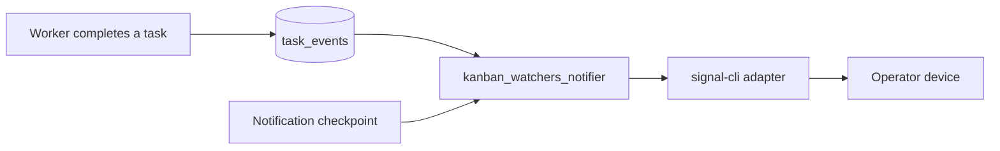
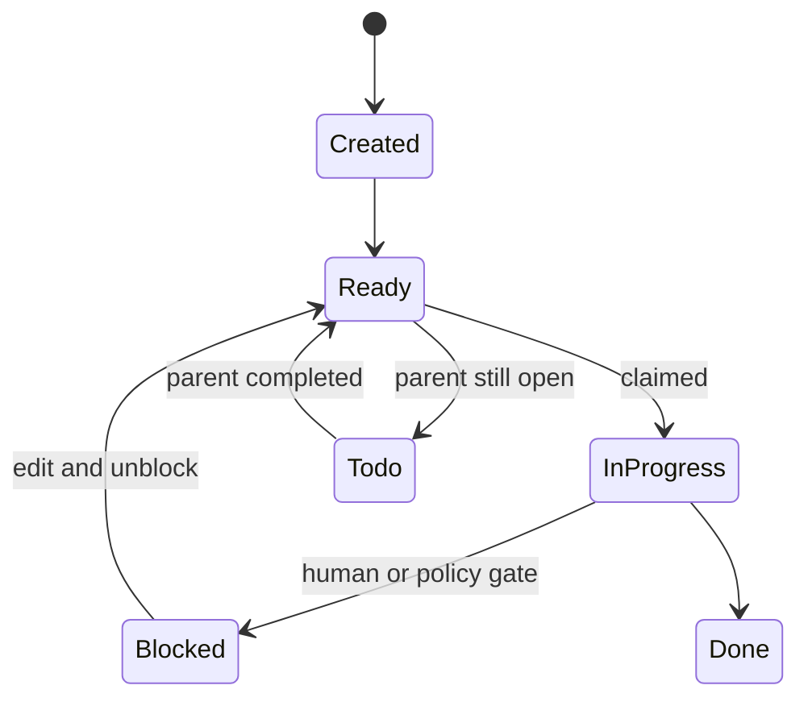

# Architecture

Hermes Agent lab on Kali Linux. This page is the component breakdown behind the [README](../README.md). It describes the system that was observed in the session. It does not add services that were not running.

## Runtime layout

```text
Windows host
  └── VMware Workstation
        └── Kali guest (account cybergeorge)
              ├── Hermes Gateway http://127.0.0.1:9119
              │     ├── Dashboard and profile config
              │     ├── Kanban dispatcher (researcher board, Auto)
              │     └── Kanban notifier watcher
              ├── signal-cli / Signal adapter
              ├── ~/.hermes/config.yaml
              ├── ~/.hermes/kanban.db
              ├── ~/.hermes/skills/productivity/sms-custom-sender/
              ├── ~/.hermes/hermes-agent/gateway/
              └── ~/hermes-workspaces/
                    ├── sms-gateway/
                    └── dhl-tracking-lab/
```

Observed version: Hermes Agent v0.23.1 (Nous Research), from the dashboard footer.

## Control plane

The gateway process serves the local UI and owns orchestration. Session evidence:

- Gateway Status: Running while tasks were blocked, revised, and in progress.
- Active sessions: 0 during the early blocked-skill capture, 2 while the parent tracking task was in flight.
- Orchestration: Auto, with a manual dispatcher nudge in the UI.
- Kanban configuration included `review_dispatch: true`.

Gateway modules located while debugging Signal delivery:

| Module | Role in the investigation |
| --- | --- |
| `gateway/run.py` | Imports `GatewayKanbanWatchersMixin` |
| `gateway/kanban_watchers.py` | Watcher plumbing |
| `gateway/kanban_watchers_notifier.py` | Turns task events into notifications |
| `gateway/kanban_watchers_dispatcher.py` | Dispatch side of the same watcher package |

The search that found those files is [Figure 5](screenshots/05-gateway-kanban-notifier.png).

## Profiles and workers

| Profile | Observed use |
| --- | --- |
| `default` | Research, `sms-custom-sender`, local simulator, Signal tests, parent tracking task |
| `dhlpackagetracker` | Child tracking-demo task `t_cd335286` |

The `default` profile text visible in the dashboard describes offensive security testing and reverse-engineering work together with review. Workers claim a card, bind the workspace on the card, heartbeat, and then complete, block, or wait on a dependency.

## Persistence

`~/.hermes/kanban.db` stores tasks, the append-only event log, notification subscriptions, and the checkpoints the notifier uses as watermarks. The board is a view of that database. Notification debugging used the event ID and the checkpoints, not the Done column alone.

## Notification path



The watcher can only deliver events that exist after the subscription and after the stored checkpoint. A subscribe call against an already-completed task does not rewind that checkpoint. That ordering rule is the root cause of the silent Signal tests, documented in [engineering challenges](engineering-challenges.md#incident-a--missing-signal-notifications).

## Task flow



Columns actually visible on the `researcher` board: Triage, Todo, Scheduled, Ready, In Progress, Blocked, Review, Done.

## Security boundaries that were in effect

| Boundary | What was observed |
| --- | --- |
| Network | Gateway bound to localhost `127.0.0.1:9119` in the captures |
| VM isolation | Agent ran in the Kali guest, not on the Windows host |
| Human release | Blocked cards require unblock; review dispatch was enabled |
| Secrets | Chat identifiers covered in committed screenshots; no credentials committed |
| Credentials in the case study | Revised task text requires environment-configured admin credentials and no hardcoded passwords |
| Live SMS | Worker refused to invent a signup; simulator task forbids real sends |

## What is intentionally absent

This repository does not contain application source, a Docker deployment, a public tunnel, or a second orchestration service. Those were not part of the verified lab. The tracking demo remains a pair of Kanban tasks under `~/hermes-workspaces/dhl-tracking-lab`.

## Future extensions

Not implemented here:

- Extra research boards that stay blocked until an operator approves the scope.
- Skills that only package notes and evidence.
- Separate Signal routes for blocked tasks and completions.
- A check that fails when a new subscription’s checkpoint is already past the latest event.
- An implementation of the revised tracking demo, tested on its own.

See the [README architecture section](../README.md#20-architecture-diagrams-and-future-extensions).
